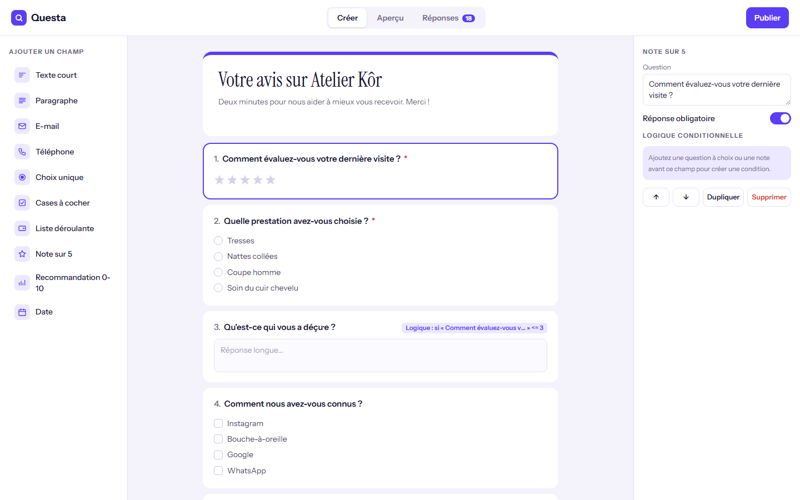
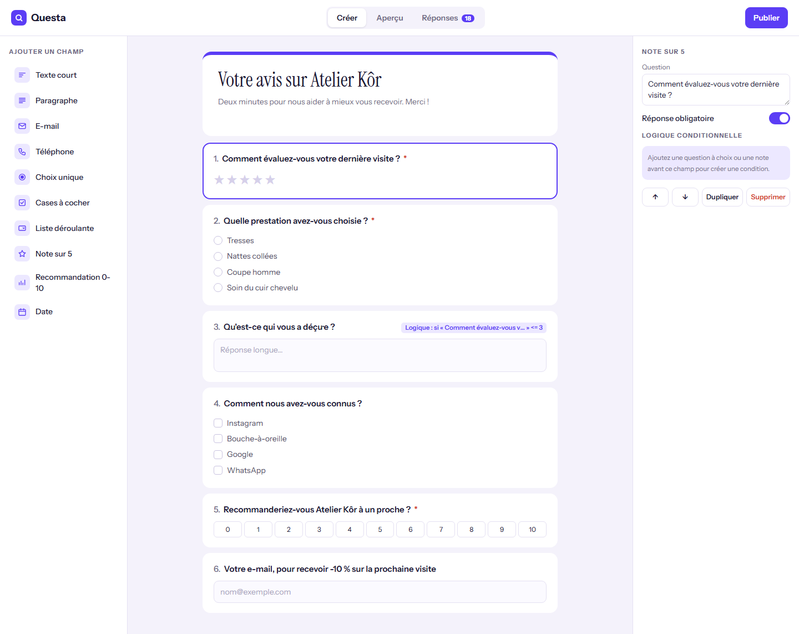
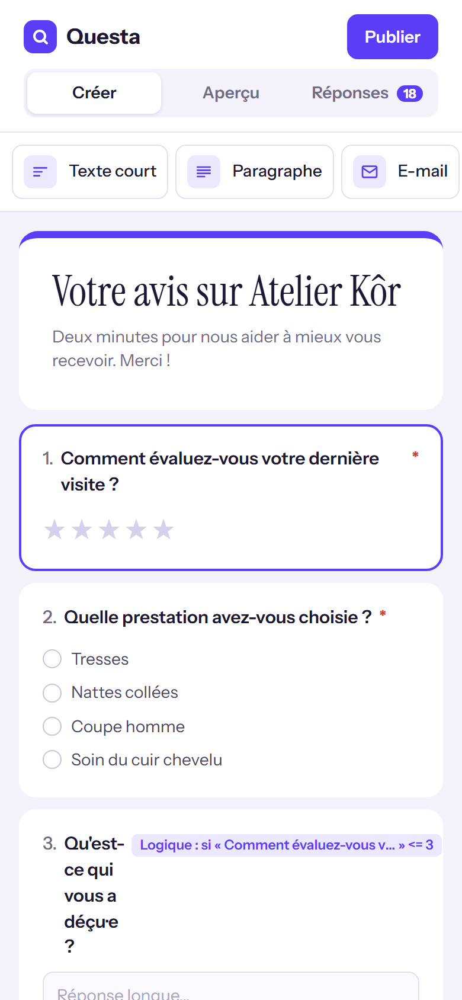

# Questa

**Créateur de formulaires et questionnaires sans code** — Outil no-code pour créer des formulaires, sondages et questionnaires de satisfaction : dix types de champs, réorganisation par glisser-déposer, propriétés et options modifiables, logique conditionnelle, aperçu interactif avec validation et barre de progression, tableau des réponses, synthèses (dont le NPS) et export CSV.

**Démo en ligne : [https://lordlennyx.github.io/questa-formulaires/](https://lordlennyx.github.io/questa-formulaires/)**

Spot de présentation (30 s) : [media/spot-30s.mp4](https://lordlennyx.github.io/questa-formulaires/media/spot-30s.mp4)

## Ce que le projet montre

- Dix types de champs : texte, paragraphe, e-mail, téléphone, choix unique, cases, liste, note sur 5, recommandation 0-10, date
- Réorganisation par glisser-déposer ou flèches, duplication, suppression
- Logique conditionnelle : afficher une question selon une réponse précédente (=, ≤, ≥)
- Aperçu répondant : apparition animée des questions conditionnelles, progression, validation et contrôle de l'e-mail
- Réponses : indicateurs, synthèse par question avec score NPS, tableau, export CSV compatible Excel
- Lien de partage et code d'intégration

## Réalisation

- **Stack :** HTML, CSS, JavaScript natif
- **Typographies :** Instrument Serif, Instrument Sans
- **Évolutions possibles :** stockage des réponses (Supabase, Google Sheets), notifications e-mail et WhatsApp, paiement dans le formulaire, mode une question par écran

| Bureau | Mobile |
|---|---|
|  |  |

---

Client et contenus fictifs, créés pour la démonstration. Conception, design et développement : **Njundiyimun Béchard** — [github.com/LordLennyx](https://github.com/LordLennyx)
